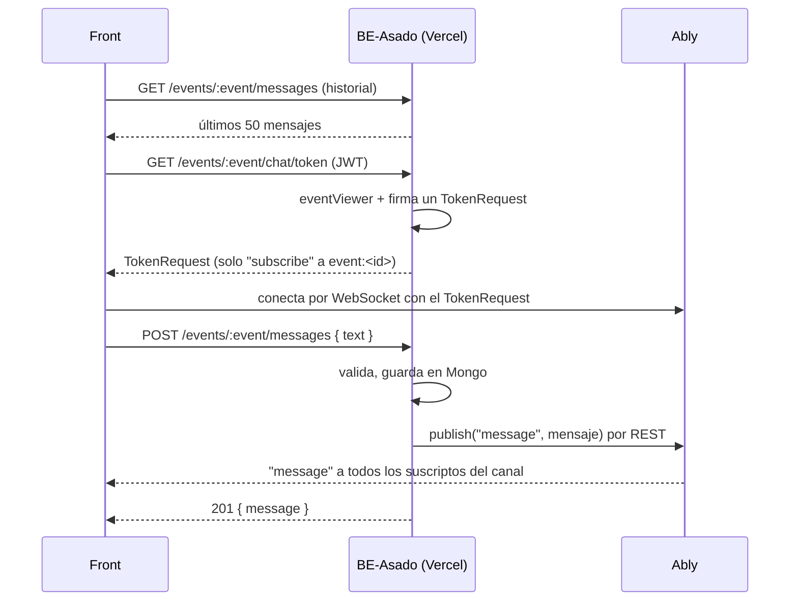

# Feature: Chat por evento

> Estado: **diseño cerrado (2026-11-24)**. Realtime con Ably (sección 6).
> ✅ = decidido. ⏸️ = en espera, se retoma más adelante.

## 1. Propuesta

Cada evento tiene un chat en tiempo real.

- Un mensaje tiene **texto, hora y autor**. No hay reacciones, edición, borrado, mensajes de sistema ni contador de no leídos. ✅
- **Escriben** los participantes del evento (`event.members`). ✅
- **Leen** los miembros del grupo del evento. Usa la misma regla que para ver el evento (`assertViewer`), así que también leen los miembros del evento que ya salieron del grupo. ✅
- En los eventos `finished` y `cancelled` el chat queda **de solo lectura**. ✅
- Al borrar el evento se borran sus mensajes en cascada. ✅
- Si el autor borra su cuenta, sus mensajes quedan y se muestran como de "Usuario eliminado". ✅

## 2. Modelo de datos

### 2.1 `Message` (colección nueva)

| Campo | Tipo | Notas |
|---|---|---|
| `event` | `ObjectId → Event`, required, immutable | |
| `author` | `ObjectId → User`, required, immutable | Siempre sale del JWT, nunca del body. |
| `text` | `String`, required, trim, **1 a 1000 caracteres** | Rechaza texto vacío o con solo espacios. |
| `createdAt` | `Date`, default `Date.now`, immutable | Lo fija el servidor. Es la "hora" del mensaje. |

Índice: `{ event: 1, createdAt: -1, _id: -1 }`. Cubre el historial paginado del más nuevo al más viejo.

El evento no guarda `messages[]`. La relación vive en `Message.event`, por la misma razón que `Event.group` en grupos: evita un array que crece sin límite.

### 2.2 Representación en la API

```json
{
  "_id": "…",
  "event": "…",
  "text": "Llevo el carbón",
  "createdAt": "2026-11-11T21:03:00.000Z",
  "author": { "_id": "…", "name": "Ana", "lastName": "Pérez", "profilePicture": "…" }
}
```

- Si el autor existe, `author` sale del `populate`, sin datos sensibles, y muestra siempre el nombre actual.
- Si el autor borró su cuenta, `author` llega como `null` y el front muestra "Usuario eliminado".

## 3. Autorización

| Operación | Regla | Dónde se valida |
|---|---|---|
| Leer historial | Miembro del grupo del evento o miembro del evento | `eventViewer` (existente) |
| Enviar mensaje | Miembro del evento **y** evento no `finished`/`cancelled` | `eventParticipant` (existente) + chequeo de estado en el service → `409 Conflict` |
| Pedir token de Ably | Igual que leer | `eventViewer` |
| Escuchar el canal en Ably | Token vigente con `subscribe` sobre `event:<id>` | Ably (sección 6.2) |
| Publicar en el canal | Solo BE-Asado, con la API key | Ningún token de cliente tiene `publish` |

## 4. API propuesta (BE-Asado, Vercel)

| Método | Ruta | Descripción |
|---|---|---|
| `GET` | `/api/events/:event/messages?before=<messageId>&limit=50` | Historial del más nuevo al más viejo, paginado por cursor. `limit` va de 1 a 100 y por defecto es 50. |
| `POST` | `/api/events/:event/messages` | Body `{ text }`. Guarda el mensaje, lo publica en Ably y responde `201` con el mensaje. |
| `GET` | `/api/events/:event/chat/token` | Devuelve un *TokenRequest* de Ably para escuchar el canal del evento (sección 6.2). |

El envío va siempre por REST. Así la validación, la autorización y los tests (supertest) quedan igual que en el resto de la API, y Ably solo **distribuye** mensajes que ya están guardados.

## 5. Cascadas

- **Borrar el evento o el grupo:** se agrega `Message.deleteMany({ event: { $in: ids } })` a `EventRepository.deleteCascade`. Ese método lo usan los dos flujos y ya corre dentro de la transacción del borrado del grupo.
- **Borrar un usuario:** no requiere cambios. Sus mensajes quedan y el `populate` devuelve `author: null` (ver 2.2).

## 6. Realtime: Ably ✅

Vercel corre la API como función serverless y no puede mantener WebSockets abiertos. Por eso se usa **Ably**, un servicio gestionado: mantiene las conexiones de los clientes y reparte los mensajes. Se descartaron un servicio de sockets propio y mudar la API a otro host, porque ningún hosting gratis mantiene un proceso prendido sin cold starts de ~1 minuto.

### 6.1 Flujo



- **Mongo es la fuente de verdad.** Ably no guarda mensajes: la persistencia de Ably queda desactivada y el historial sale de la API.
- **Canal:** cada evento tiene el suyo, `event:<eventId>`. Nombre del evento Ably: `message`. El payload es el mensaje de 2.2.

### 6.2 Tokens

- BE-Asado firma localmente un *TokenRequest* con `ably.auth.createTokenRequest`, sin llamar a Ably. Lleva:
  - `clientId`: el id del usuario;
  - `capability`: `{ "event:<id>": ["subscribe"] }`;
  - `ttl`: 15 minutos.
- El SDK del front renueva el token solo, llamando de nuevo al endpoint. En cada renovación **se vuelve a validar `eventViewer`**: quien sale del grupo pierde el acceso en como mucho 15 minutos.
- Los clientes nunca reciben `publish`. Todo mensaje pasa por la validación de la API.

### 6.3 Publicación

- Después de guardar, `MessageService` publica con `Ably.Rest` (HTTP), con `await` antes de responder, porque Vercel congela la función después de la respuesta.
- Si Ably falla, se loguea y el `POST` responde `201` igual, porque el mensaje ya está guardado.
- El emisor también recibe el mensaje por el canal, así que el front deduplica por `_id`.
- El publicador va detrás de una interfaz (`MessagePublisher`). Los tests usan un fake, y cambiar de proveedor solo toca esa implementación y el endpoint del token.

### 6.4 Consistencia

- El SDK reconecta solo. Si el corte dura menos de ~2 minutos, Ably entrega los mensajes perdidos. Si dura más, el front vuelve a pedir el historial y lo une con lo que ya tiene, deduplicando por `_id`.

### 6.5 Configuración

- **Apps de Ably:** una para prod y otra para dev.
- **API key:** una por app, restringida a los canales `event:*` con capacidades `publish` y `subscribe`. Necesita `subscribe` porque un token solo puede tener capacidades que la key tenga.
- **Variables:** `ABLY_API_KEY` en `.env` local (con la key de dev) y en Vercel: Production con la key de prod, y el entorno del deploy de `dev` con la key de dev. Se agrega a `.env.example` sin valor.
- **Free tier** (verificar en ably.com): ~6M mensajes/mes y 200 conexiones concurrentes. Cada mensaje cuenta 1 vez al publicarse más 1 por suscriptor que lo recibe. El front cierra la conexión al salir de la pantalla del chat.

## 7. Plan de implementación (tentativo)

1. ✅ **Modelo `Message` y cascadas.** Schema, índice e interfaz. Borrado en `EventRepository.deleteCascade`, que cubre el borrado del evento y del grupo. Tests.
2. **Endpoints REST.** `MessageRepository`, `MessageService`/`MessageController`, rutas con `eventViewer`/`eventParticipant`, regla de solo lectura por estado (`409`), paginación por cursor y mapeo del autor. Tests unitarios y de integración.
3. **Ably.** `MessagePublisher` con la implementación de Ably y publicación tolerante a fallos en `POST /messages`. Endpoint `GET /events/:event/chat/token`. Config `ABLY_API_KEY`. Tests con publisher fake.
4. **Notas para el front.** Contrato de la API y del canal en `FRONTEND_CHANGES.md`.
