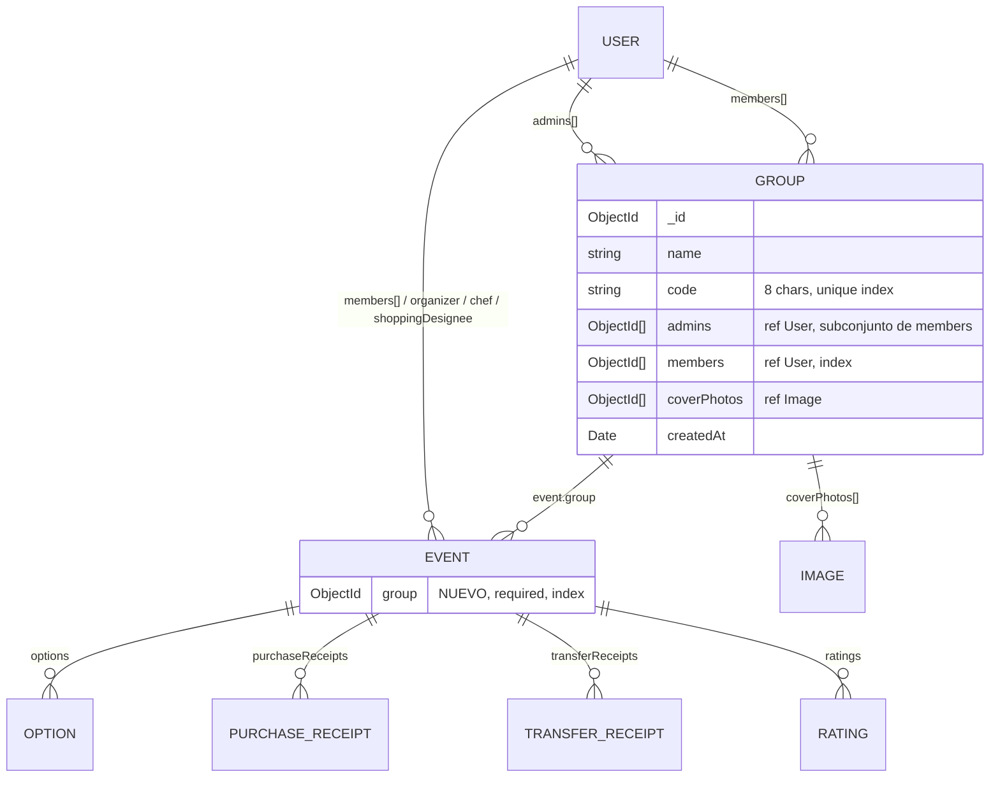
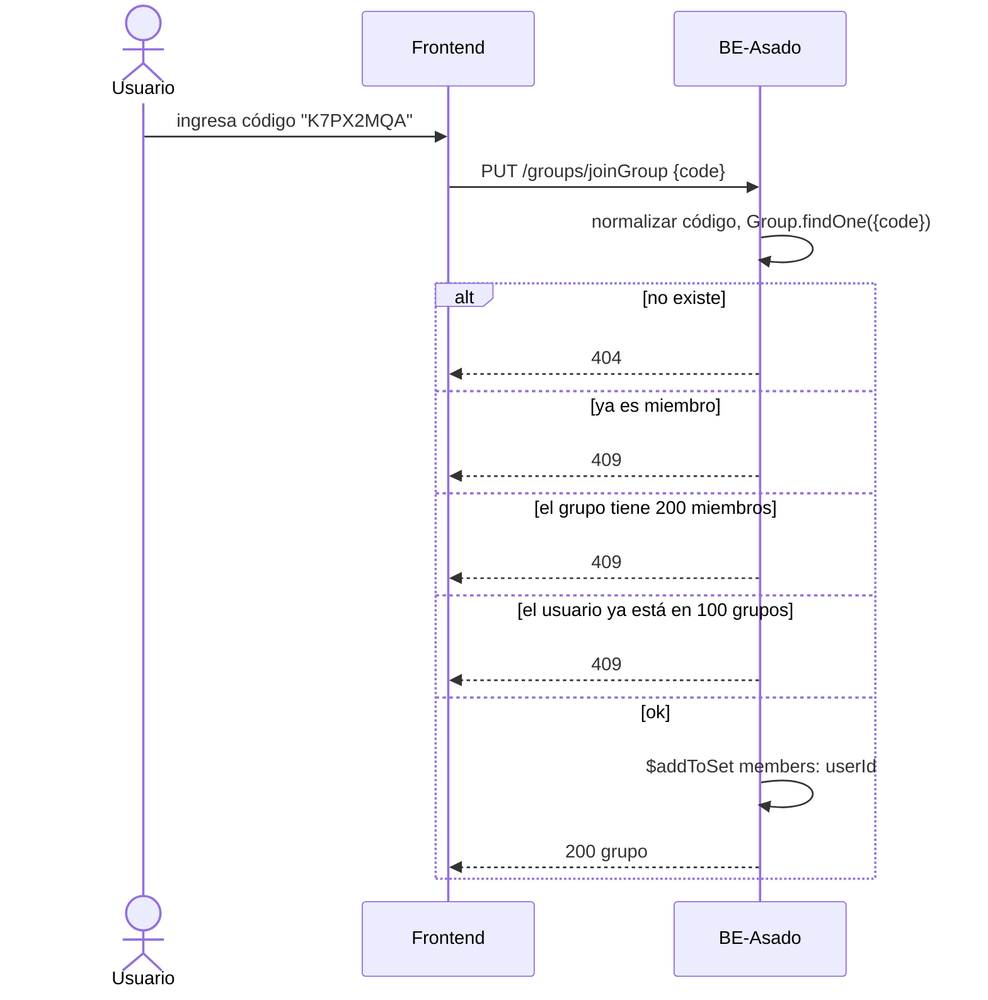
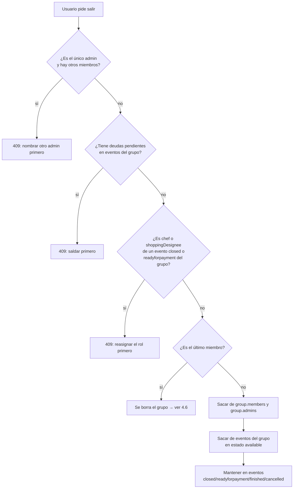

# Feature: Grupos

> Estado: **diseño cerrado (2026-10-27)**. Implementados los pasos 1 a 4 del plan (sección 9).
> ✅ = decidido. ⏸️ = en espera, se retoma más adelante. El registro completo está en la sección 10.

## 1. Problema

Hoy todos los usuarios comparten un único pool de eventos. La única forma de restringir un evento es `isPrivate`, y es incómoda:

- un evento privado no aparece en la interfaz para quien todavía no es miembro, así que hay que pasarle el link;
- la privacidad se define evento por evento, no por "círculo de gente".

## 2. Propuesta

Introducir **grupos de usuarios**:

- Un usuario pertenece a **uno o varios** grupos. ✅
- Un evento pertenece a **exactamente un** grupo. ✅
- Solo los miembros de un grupo ven y participan de sus eventos. **Desaparecen los eventos públicos.** ✅
- Un usuario entra a un grupo de alguna de estas formas:
  1. creándolo (queda como administrador);
  2. ingresando el **código del grupo** (8 caracteres alfanuméricos, único);
  3. recibiendo una **invitación por mail**.
- Un grupo tiene nombre, código, administradores, miembros, una o varias fotos de portada y sus eventos.

## 3. Modelo de datos

### 3.1 Diagrama

### 3.2 `Group` (colección nueva)

| Campo | Tipo | Notas |
|---|---|---|
| `name` | `String`, required, **máximo 50 caracteres** ✅ | |
| `code` | `String`, required, **unique index** | 8 chars, ver 3.4 |
| `admins` | `[ObjectId → User]`, al menos uno | Siempre es un subconjunto de `members` ✅ (varios admins) |
| `members` | `[ObjectId → User]`, **máximo 200** ✅ | Índice en `members` para "mis grupos" |
| `coverPhotos` | `[ObjectId → Image]`, **máximo 5** ✅ | |
| `createdAt` | `Date` | |

Decisiones de modelado propuestas:

- **La membresía vive solo en `Group.members`** y no se duplica en `User`. "Mis grupos" se obtiene con `Group.find({ members: userId })`. Así hay una sola fuente de verdad, igual que `Event.members` hoy.
- **El grupo no guarda `events[]`**. La relación vive en `Event.group` (indexado). Así se evitan arrays que crecen sin límite y tener que sincronizar los dos lados.
- **Invariante:** un grupo con miembros siempre tiene al menos un admin, y todo admin es miembro.

### 3.3 `Event` (cambios)

- Nuevo campo `group: ObjectId → Group`, **required**, indexado.
- ✅ El `group` se fija al crear el evento y **no se puede editar**. Un evento es propio de un grupo, solo puede estar en uno y no se mueve a otro. `editEvent` no acepta `group`.
- **Se elimina `isPrivate`** del schema, de `CREATE_EVENT_FIELDS`, de `editEvent`, de `IEvent`/`IPublicEvent` y de `reduceEventsInformation`. ✅

### 3.4 Código del grupo

- Son 8 caracteres de un alfabeto sin caracteres ambiguos: `ABCDEFGHJKMNPQRSTUVWXYZ23456789` (sin `0/O` ni `1/I/L`). Eso da 31⁸ ≈ 8,5 × 10¹¹ combinaciones.
- Se guarda en mayúsculas, y lo que ingresa el usuario se normaliza con `trim().toUpperCase()`.
- Se genera con `crypto.randomInt` (no con `Math.random`). La unicidad la garantiza el índice único: si el `save` falla por clave duplicada, se regenera el código y se reintenta.
- ✅ **Cualquier admin puede regenerar el código.** El código anterior deja de servir en el acto. Es la forma de cortar el ingreso de gente nueva si el código se filtró. Con la opción A de invitaciones (4.3), regenerar el código también invalida los links de invitación ya enviados.
- ⚠️ La API todavía no tiene rate limiting (pendiente en `WORKTODO.md` §6.A). `joinGroup` debería quedar cubierto cuando se agregue.

### 3.5 Fotos de portada

- Reutilizan el modelo `Image` existente: buffer en Mongo, límite de 5 MB y `multerUploadImages` (PNG/JPEG).
- Hoy `getImage` permite ver las fotos de perfil a cualquier usuario logueado, y las imágenes de comprobantes solo a los miembros del evento. Hay que agregar una regla: **portada de grupo → miembros del grupo**.
- Cómo se muestran las portadas lo decide el front. El backend las devuelve en el orden en que se subieron.

## 4. Flujos

### 4.1 Crear grupo

`POST /groups/createGroup` con `{ name }`. El grupo se crea con `admins = members = [usuario del JWT]` y un código nuevo. Los admins y los miembros salen **siempre del JWT**, nunca del body.

### 4.2 Unirse por código

### 4.3 Invitación por mail

✅ **Se empieza con la opción A y la meta es la opción B.** La opción A tiene que poder convivir con la B sin cambiar el contrato de `joinGroup`.

**A. El mail lleva el código (v1).**
Un admin ingresa uno o varios mails. El backend envía un mail con el link `https://food-spot.vercel.app/join/<CODE>`. Si el usuario no está logueado, el frontend lo manda a login o registro y después llama a `joinGroup`.
- ➕ No requiere una colección nueva y funciona igual para usuarios registrados y no registrados.
- ➖ No se pueden listar las invitaciones pendientes ni revocar una sola. El link sirve para cualquiera que lo reciba.

**B. Invitaciones con token propio (objetivo).**
Una colección `Invitation { group, email, invitedBy, tokenHash, expiresAt, status }`. El link lleva un token de un solo uso. Al aceptarlo se verifica que el mail del usuario logueado coincida con el invitado.
- ➕ Las invitaciones se pueden rastrear y revocar, vencen y quedan atadas a una persona.
- ⏸️ A definir al implementar B: ¿qué pasa si la persona se registra con otro mail? ¿El código del grupo sigue existiendo junto a las invitaciones?

Para que A no limite a B: `inviteToGroup` recibe `{ emails: [] }` en ambas versiones. Lo único que cambia es el contenido del mail y que se agrega un endpoint `acceptInvitation`.

### 4.4 Salir de un grupo

✅ No se puede salir mientras el usuario tenga deudas pendientes en eventos del grupo, ni mientras sea `chef` o `shoppingDesignee` de un evento `closed` o `readyforpayment` del grupo.

Qué permite cada estado del evento:

| Estado | Participantes | Comprobantes | Efecto al salir del grupo |
|---|---|---|---|
| `available` | Se pueden unir y salir | — | Se lo da de baja del evento automáticamente y se liberan sus roles |
| `closed` | Bloqueada la entrada y salida | Se cargan `purchaseReceipts` | Sigue en el evento. Si es chef o designee, **no puede salir** |
| `readyforpayment` | Bloqueada | Bloqueados los `purchaseReceipts`; se cargan `transferReceipts` | Sigue en el evento. Si es chef o designee o tiene deuda, **no puede salir** |
| `finished` | Todo bloqueado. Solo se llega cuando se aprueban todos los pagos | — | Sigue en el evento (historial) |
| `cancelled` | Todo bloqueado | — | Sigue en el evento (historial) |

- En los eventos `available`, ser chef o designee no bloquea: la baja automática del evento también libera esos roles.
- ✅ **`unsubscribeFromEvent` libera los roles** (paso 4) cuando el evento está `available`, igual que la baja automática al salir del grupo. En `finished`/`cancelled` (los únicos otros estados donde se puede desuscribir) los roles quedan como historial, porque desde `closed` en adelante están congelados (4.4.2).
- Las deudas se chequean reutilizando la lógica de `isDebtor`/`hasPendingTransfers`, filtrada por los eventos del grupo.
- Un ex-miembro que sigue en `members` de un evento terminado puede seguir viendo ese evento: para leer un evento alcanza con ser miembro del grupo **o** miembro del evento (ver 5.1).
- ✅ **Al salir, se lo saca automáticamente de los eventos `available` del grupo, pero no de los `closed`.** En esos eventos sigue siendo miembro, porque un evento cerrado ya tiene la gente y las compras definidas. La baja reutiliza la lógica de `unsubscribeFromEvent`, que también lo saca de las opciones que votó.

#### 4.4.1 ¿El organizer puede salir?

⏸️ **En standby.** La idea inicial es que ser `organizer` de un evento activo no bloquee la salida: el organizer tiene poco poder sobre el evento, y el evento puede seguir sin él. En ese caso, `Event.organizer` seguiría apuntando al ex-miembro, sin reasignarse ni ponerse en `null`. Antes de confirmarlo falta resolver qué pasa con `deleteEvent` (ver la tabla).

Qué queda en manos del organizer hoy y qué pasa si sale:

| Operación | Autorización actual | Si el organizer salió |
|---|---|---|
| Editar el evento (`editEvent`) | organizer **o** designee | La sigue haciendo el designee |
| Gestionar opciones (`optionManager`) | organizer **o** designee | La sigue haciendo el designee |
| Ver costos de otros (`getMemberIndividualCost`) | organizer **o** designee | La sigue haciendo el designee |
| **Borrar el evento** (`deleteEvent`, middleware `eventOrganizer`) | **solo organizer** | **Nadie puede borrarlo.** Se puede pasar a `cancelled` con `editEvent`. ⏸️ ¿Alcanza con cancelarlo, o el borrado pasa a ser organizer **o** designee? |
| Editar roles (`editRoles`) | Hoy solo `auth`: cualquiera asigna cualquier rol a cualquiera | No depende del organizer: ver "Autoasignación de roles" abajo |

✅ **Los permisos de organizer exigen además ser miembro actual del grupo.** El organizer que sale sigue pudiendo **ver** el evento si es miembro del evento (regla de 5.1), pero ya no puede editarlo ni borrarlo. Los middlewares actuales (`eventOrganizer`, `shoppingDesigneeOrEventOrganizer`, `optionManager`) solo comparan `event.organizer` con el JWT, así que hay que sumarles el chequeo de grupo.

#### 4.4.2 Autoasignación de roles

✅ **`editRoles` solo permite que el usuario del JWT se asigne a sí mismo** como `chef` o `shoppingDesignee`. (Implementado en la rama `t/groups`, junto con el chef ocupado y los roles congelados fuera de `available`; ver `FRONTEND_CHANGES.md` §22. El body se mantuvo como `{ chef, shoppingDesignee: [] }` y se acepta solo el cambio del propio usuario. Falta 9i y la liberación de roles al desuscribirse.) No se le pueden asignar roles a otro usuario. Esto reemplaza lo que proponía `WORKTODO.md` §2.2 ("solo organizer"), que ya quedó corregido allá.

- El que se asigna tiene que ser miembro del evento (y por lo tanto del grupo). Así se resuelve también `WORKTODO.md` §5 ("`editRoles` permite asignar roles a no miembros").
- Cambia el contrato: hoy el body trae `{ chef, shoppingDesignee: [] }` con IDs arbitrarios. Va a `FRONTEND_CHANGES.md`.
- ✅ **Chef ocupado:** `chef` es uno solo y es un rol simbólico. Si ya hay chef, otro miembro no puede reemplazarlo: tiene que esperar a que el actual lo suelte (409).
- ✅ **Soltar un rol:** cada uno puede quitarse su propio rol (chef o designee), y solo el suyo.
- ✅ **Estados:** los roles solo se toman o se sueltan con el evento en `available`. Desde `closed` en adelante quedan congelados (403/409). Como `closed` puede volver a `available`, los roles se reabren si el evento se reabre.

Consecuencias:
- Ningún designee puede dejar su rol en `readyforpayment`, así que no se puede quedar un evento sin nadie que apruebe los pagos por haber soltado roles.
- Para salir del grupo (4.4): en un evento `available`, los roles se liberan solos con la baja automática. En `closed`/`readyforpayment` la persona queda atada al grupo hasta que el evento termine o se cancele.
- ✅ **Un evento no puede pasar a `closed` sin al menos un `shoppingDesignee`.** El front ya lo bloquea, pero el backend tiene que validarlo igual. Va en la misma función de `editEvent` que ya valida las transiciones de estado (junto a "readyforpayment necesita al menos un comprobante de compra") y devuelve **400**, igual que las demás transiciones inválidas. No depende de los grupos: se puede implementar antes, junto con el cambio de `editRoles`.

### 4.5 Acciones del admin

✅ Un admin **solo** puede:

- cambiar el nombre del grupo;
- invitar gente (4.3);
- hacer admin a otro miembro;
- agregar o quitar fotos de portada;
- regenerar el código (3.4).

Un admin **no** gestiona eventos ajenos: editar o borrar un evento sigue siendo exclusivo de su `organizer` (y del `shoppingDesignee` donde ya aplica).

⏸️ **A evaluar.** En principio **nadie** puede hacer estas tres acciones:

| Acción | Postura actual | Qué pesa en la evaluación |
|---|---|---|
| **Expulsar a un miembro** | En teoría no se puede | Si el código se filtra, regenerarlo frena a los que todavía no entraron, pero no saca a un intruso que ya entró. Tampoco hay forma de sacar a alguien que dejó de participar. |
| **Eliminar el grupo** | En teoría no se puede | El único camino para que un grupo desaparezca es que salgan todos (4.6). Un grupo abandonado por casi todos queda vivo mientras quede una persona. |
| **Quitarle el rol de admin a alguien** | Complicado | Si cualquier admin puede quitárselo a cualquier otro, aparecen las "guerras de admins": el último en nombrarse saca a los demás. Variantes posibles: (a) nadie le quita el rol a otro, pero cada uno puede renunciar al suyo si no es el último admin; (b) el creador del grupo es "dueño" y nadie le puede quitar el rol; (c) solo el creador puede quitar admins. La variante (a) es la más simple y no rompe nada. |

### 4.6 Borrado del grupo

✅ **Cuando sale el último miembro, el grupo se borra** (borrado real, no soft delete). La cascada incluye:

- todos los eventos del grupo, con sus receipts, ratings, options, reminders e imágenes (reutilizando `deleteReceipts`/`deleteReminders`);
- las fotos de portada.

Como hoy es la única forma de que un grupo desaparezca, este es el único lugar que dispara la cascada.

Consecuencia a tener presente: los ex-miembros que seguían viendo eventos terminados del grupo porque eran miembros de esos eventos (4.4) pierden ese historial cuando se borra el grupo.

Las reglas de 4.4 garantizan que, al momento de salir, el último miembro no tiene deudas ni roles activos. Puede haber eventos activos del grupo cuyo organizer ya salió (ver 4.4.1); se borran igual en la cascada.

### 4.7 Eliminar usuario

⏸️ **Hoy el producto no ofrece eliminar la cuenta**, así que no forma parte de esta feature. Cuando se habilite, el flujo deseado ✅ es aplicar las mismas reglas que al salir de un grupo (4.4) en **cada** grupo del usuario:
- Se bloquea si tiene deudas o es chef/designee de un evento `closed`/`readyforpayment` en cualquiera de sus grupos.
- Se bloquea si es el único admin de un grupo con otros miembros, hasta que nombre a otro admin. No se promueve a nadie automáticamente.
- Si es el único miembro de un grupo, el grupo se borra (4.6).

⚠️ El endpoint `DELETE /users/deleteUser/:id` existe y responde (con `auth` + `sameUser`) y solo borra el documento `User`. Con grupos, usarlo dejaría IDs colgados en `members`/`admins` y podría dejar un grupo sin admin. Mientras el producto no lo ofrezca, conviene deshabilitarlo o implementarle estas reglas.

## 5. Autorización

### 5.1 Reglas nuevas

| Operación | Quién |
|---|---|
| Ver grupo (detalle, miembros, portadas) | Miembro del grupo |
| Listar los eventos del grupo | Miembro del grupo |
| Crear un evento en un grupo | Miembro del grupo |
| Ver un evento | Miembro del grupo del evento **o** miembro del evento |
| Suscribirse a un evento | Miembro del grupo del evento (además de las reglas actuales) |
| Unirse por código | Cualquier usuario autenticado que tenga el código |
| Salir del grupo | El propio usuario (JWT), con las restricciones de 4.4 |
| Invitar por mail | Admin |
| Cambiar el nombre | Admin |
| Agregar o quitar portadas | Admin |
| Hacer admin a un miembro | Admin |
| Regenerar el código | Admin |
| Expulsar, quitar admin, eliminar grupo | Nadie (⏸️ a evaluar, 4.5) |
| Ver una portada de grupo (`getImage`) | Miembro del grupo |
| Editar o borrar un evento | Sin cambios (organizer / designee) |

Middlewares nuevos, siguiendo el estilo de [src/middleware/middleware.ts](src/middleware/middleware.ts):

- `groupMember`: toma `:group` de los params. Devuelve 400 si el ID es inválido, 404 si el grupo no existe y 403 si el usuario no es miembro.
- `groupAdmin`: igual que el anterior, pero devuelve 403 si el usuario no es admin.
- `eventViewer`: carga el evento y su grupo, y deja pasar si el usuario es miembro del grupo o del evento.

### 5.2 Eventos públicos

✅ **Desaparecen.** Todo evento es de un grupo y solo lo ve ese grupo.

- Se eliminan `isPrivate` y `GET /events/getPublicEvents`.
- ⏸️ `getEvents` y `getPublicAndPrivateEvents`: **en espera**. La opción preferida es reemplazarlos por un único `getMyEvents` ("eventos de todos mis grupos", por ejemplo para una home que mezcle grupos) y eliminar los otros dos.

### 5.3 Endpoints abiertos que los grupos dejan sin efecto

Ya figuran en `WORKTODO.md` §2.3: `getEventById`, `getMembersAndReceiptsInfo` y `getMembersAmount` responden sin `auth`. Con grupos dejan de ser algo "a revisar" y pasan a ser **requisito**: si siguen abiertos, cualquiera ve los eventos de cualquier grupo. Se resuelven con `auth` + `eventViewer`.

✅ **Resuelto en el paso 4:** los tres usan `auth` + `eventViewer` ("miembro del grupo del evento **o** miembro del evento"), y `subscribeToAnEvent` exige ser miembro del grupo. Queda como registro lo que se hizo en el paso 1:

✅ **Paso 1 hecho (rama `t/groups`), con una regla provisoria hasta que exista `Event.group`:**
- Los tres exigen `auth`.
- `getEventById` lo ve cualquier usuario logueado, también si el evento es privado, porque hoy el link es la única forma de sumarse a un evento privado (§1).
- `getMembersAndReceiptsInfo` y `getMembersAmount` usan `eventViewer`: si el evento es público, cualquier logueado; si es privado, solo sus miembros.

Pendiente para el paso 4, que vino de `TOFIX.md` (borrado):
- `getEventById` pasa a `eventViewer`.
- `eventViewer` pasa a "miembro del grupo **o** del evento". Hoy, en un evento público, cualquier logueado ve montos y CBU/alias.
- `subscribeToAnEvent` valida la membresía en el grupo. Hoy cualquiera con el id se suma a un evento privado; es el flujo del link y no se puede cerrar antes de tener grupos.

Otros endpoints a revisar:

| Endpoint | Problema con grupos |
|---|---|
| `GET /events/getEvents`, `getPublicAndPrivateEvents` | Filtran por `isPrivate`, no por grupo (ver 5.2) |
| `GET /users/getUsers` | Devuelve todos los usuarios del sistema. ⏸️ **En espera:** ¿restringirlo a "usuarios con los que comparto grupo"? Antes hay que ver cuánto lo usa el front. |
| `GET /users/getUserById/:id` | Mismo caso ⏸️ |

Los endpoints que hoy validan "miembro del evento" (`eventParticipant`, `optionVoter`, ratings, receipts) siguen siendo correctos: para ser miembro del evento, el usuario tuvo que ser miembro del grupo al suscribirse.

### 5.4 Efectos colaterales en la lógica existente

- **`deleteEvents()`** ([src/controllers/events.ts](src/controllers/events.ts)): se ejecuta en cada `createEvent`. Cuenta los eventos públicos **globales** y, cuando hay más de 6, borra los finished/cancelled más viejos. Al eliminar `isPrivate`, el conteo deja de tener sentido, y con grupos borraría eventos (con su historial financiero) de otros grupos. ✅ **Se elimina `deleteEvents()`** junto con su llamada en `createEvent`. Los eventos terminados quedan como historial del grupo.
- **`notifyNewEvent`**: hoy manda el mail a todos los usuarios con `notifications.newEvent`. Tiene que mandarlo solo a los **miembros del grupo** del evento, sin incluir al organizador. Se elimina el chequeo `event.isPrivate`.
- **`createEvent`**: hoy crea el Reminder `newEvent` solo si `!isPrivate`. Pasa a crearlo siempre, porque el filtro lo hace el grupo.
- **Templates de mail**: el mail de nuevo evento debería mencionar el grupo. Hace falta un template nuevo para la invitación.
- **`isDebtor` / `hasPendingTransfers`**: siguen siendo globales. Para 4.4 hace falta una variante por grupo.

## 6. API propuesta

Siguiendo la convención actual (`/recurso/verboRecurso/:params`):

| Método | Ruta | Middlewares | Descripción |
|---|---|---|---|
| POST | `/groups/createGroup` | `auth` | Crea el grupo; el usuario queda como admin |
| GET | `/groups/getMyGroups` | `auth` | Grupos del usuario (resumen: nombre, portada, cantidad de miembros) |
| GET | `/groups/getGroupById/:group` | `auth, groupMember` | Detalle + miembros (sin datos sensibles) + admins |
| PUT | `/groups/joinGroup` | `auth` | Body `{ code }` |
| PUT | `/groups/leaveGroup/:group` | `auth, groupMember` | Ver 4.4 |
| POST | `/groups/inviteToGroup/:group` | `auth, groupAdmin` | Body `{ emails: [] }` |
| PUT | `/groups/editGroup/:group` | `auth, groupAdmin` | Nombre |
| PUT | `/groups/makeAdmin/:group/:user` | `auth, groupAdmin` | El destino tiene que ser miembro |
| PUT | `/groups/regenerateCode/:group` | `auth, groupAdmin` | Devuelve el código nuevo |
| POST | `/groups/addCoverPhoto/:group` | `auth, groupAdmin, multerUploadImages.single("file")` | |
| DELETE | `/groups/deleteCoverPhoto/:group/:image` | `auth, groupAdmin` | |
| GET | `/events/getGroupEvents/:group` | `auth, groupMember` | Listado de eventos para la UI del grupo |

Pendientes según lo que se evalúe en 4.5: `removeAdmin` (o `renounceAdmin`), `removeMember` y `deleteGroup`.
Para la opción B (4.3) se agrega: `acceptInvitation`.

Cambios en los endpoints de eventos:

- `createEvent`: requiere `group` en el body y valida que el usuario del JWT sea miembro del grupo. (`organizer` ya se toma del JWT: implementado en `t/groups`.)
- `subscribeToAnEvent`: valida la membresía en el grupo.
- `getEventById`, `getMembersAndReceiptsInfo`, `getMembersAmount`: pasan a usar `auth` + `eventViewer`.
- `getPublicEvents`: se elimina. `getEvents` / `getPublicAndPrivateEvents`: ver 5.2.
- `editEvent`: deja de aceptar `isPrivate`.

Cada cambio de contrato se documenta en `FRONTEND_CHANGES.md`.

## 7. Datos existentes

✅ **No hay migración: la base de datos se reinicia por completo** al lanzar la feature. Por lo tanto:

- `Event.group` puede ser `required` desde el primer día, sin un período de transición.
- `isPrivate` se borra directamente, sin script.
- El código de compatibilidad con eventos viejos también puede eliminarse, por ejemplo los `// esto es porque eventos viejos no tienen el atributo` de `reduceEventsInformation` (que de todos modos desaparece junto con `getPublicEvents`).

## 8. Límites y validaciones

| Límite | Valor | Dónde se valida | Error |
|---|---|---|---|
| Miembros por grupo | **200** ✅ | `joinGroup` (y `acceptInvitation` en la opción B) | 409 |
| Grupos por usuario (creados + unidos) | **100** ✅ | `createGroup`, `joinGroup` | 409 |
| Fotos de portada por grupo | **5** ✅ | `addCoverPhoto` | 409 |

- El tope de 200 miembros se aplica de forma atómica, en el mismo update: `findOneAndUpdate({ code, "members.199": { $exists: false } }, { $addToSet: { members } })`. Así dos ingresos simultáneos no pueden pasarse del límite.
- Propuesta: **no** validar que el `memberLimit` de un evento sea menor o igual a la cantidad de miembros del grupo, porque el grupo puede crecer después.

## 9. Plan de implementación (tentativo)

1. **Cerrar los endpoints abiertos** de 5.3 (`WORKTODO.md` §2.3). No depende de los grupos y se puede hacer ya. ✅ (PR #157)
2. Modelo `Group` + generación del código + tests unitarios. ✅ (rama `t/groups-model`: `src/models/group.ts`, `src/modules/groups/groupCode.ts`, `GroupRepository.createWithUniqueCode`)
3. Endpoints de grupo (crear, mis grupos, detalle, unirse, salir con borrado en cascada del grupo vacío, editar, makeAdmin, regenerateCode) + middlewares `groupMember`/`groupAdmin` + tests de integración. ✅ (rama `t/groups-model`). Salir aplica por ahora solo las reglas propias del grupo (único admin → 409, último miembro → se borra el grupo con sus portadas); las reglas que dependen de eventos (deudas, roles en `closed`/`readyforpayment`, baja de los `available`, borrar los eventos del grupo) se agregan en el paso 4 (hay un `TODO` en `GroupService.leave`).
4. `Event.group` + cambios en `createEvent`, `subscribeToAnEvent`, `eventViewer` y los listados. ✅ (rama `t/groups-model`):
   - `Event.group` required, indexado e inmutable; `createEvent` exige `group` y que el organizador sea miembro.
   - `subscribeToAnEvent` exige ser miembro del grupo; `getEventById`, `getMembersAndReceiptsInfo` y `getMembersAmount` usan `eventViewer` (grupo **o** evento).
   - Los permisos de organizer exigen ser miembro actual del grupo (9e): `eventOrganizer`, `shoppingDesigneeOrEventOrganizer`, `optionManager` y ver costos de otros.
   - Nuevo `GET /events/getGroupEvents/:group`.
   - `leaveGroup` aplica todas las reglas de 4.4 (deudas, roles en `closed`/`readyforpayment`, baja de los `available`) y el borrado del grupo vacío incluye sus eventos (4.6), cada uno en una transacción.
   - `unsubscribeFromEvent` libera los roles en eventos `available`.
   - ⏸️ Sin cambios: `getEvents`, `getPublicAndPrivateEvents` y `getPublicEvents` siguen filtrando por `isPrivate` y muestran eventos de todos los grupos (5.2 y paso 8).
5. Notificaciones por grupo + eliminar `deleteEvents()`.
6. Portadas (subir, borrar y acceso en `getImage`).
7. Invitaciones por mail, opción A.
8. Eliminación de `isPrivate`, `getPublicEvents` y el código de compatibilidad con eventos viejos (sin migración, ver 7).
9. Invitaciones por mail, opción B.
10. `FRONTEND_CHANGES.md` actualizado en cada paso.

## 10. Registro de decisiones

| # | Decisión | Estado |
|---|---|---|
| 1 | Un evento pertenece a exactamente un grupo | ✅ |
| 2 | Un usuario puede estar en varios grupos | ✅ |
| 3 | Desaparecen los eventos públicos: se eliminan `isPrivate` y `getPublicEvents` | ✅ 2026-10-27 |
| 4 | Invitaciones: empezar con la opción A (mail con el código), la meta es la B (token propio) | ✅ 2026-10-27 |
| 5 | No se puede salir del grupo con deudas pendientes ni siendo chef/designee de un evento activo | ✅ 2026-10-27 |
| 6 | El admin solo puede renombrar, invitar, hacer admin a otros y cambiar las portadas. No gestiona eventos ajenos | ✅ 2026-10-27 |
| 7 | Varios admins por grupo (`admins[]`), siempre al menos uno | ✅ 2026-10-27 (se deduce de 6) |
| 8 | Membresía solo en `Group.members`; relación con eventos solo vía `Event.group` | propuesta |
| 9 | Cualquier admin puede regenerar el código | ✅ 2026-10-27 |
| 9b | Expulsar miembros, eliminar el grupo y quitar el rol de admin: en principio nadie puede | ⏸️ a evaluar |
| 9c | Cuando sale el último miembro, el grupo se borra (borrado real, en cascada) | ✅ 2026-10-27 |
| 9d | El organizer de un evento activo puede salir del grupo; el evento sigue sin él | ⏸️ standby (falta resolver `deleteEvent`) |
| 9e | Los permisos de organizer exigen ser miembro actual del grupo | ✅ 2026-10-27 |
| 9f | `editRoles` solo permite autoasignarse un rol (corrige `WORKTODO.md` §2.2) | ✅ 2026-10-27 |
| 9g | Chef ocupado: hay que esperar a que se libere; cada uno puede soltar su propio rol | ✅ 2026-10-27 |
| 9h | Los roles solo cambian en `available`; desde `closed` quedan congelados | ✅ 2026-10-27 |
| 9i | No se puede pasar a `closed` sin ningún `shoppingDesignee` (400, validado en backend) | ✅ 2026-10-27 |
| 9j | Al salir del grupo se lo saca de los eventos `available`, no de los `closed` | ✅ 2026-10-27 |
| 9k | Límites: 200 miembros por grupo, 100 grupos por usuario, 5 portadas | ✅ 2026-10-27 |
| 9l | Unirse a un grupo del que ya sos miembro devuelve 409 | ✅ 2026-10-27 |
| 9m | Restringir `getUsers`/`getUserById` a usuarios con grupo en común | ⏸️ en espera (ver uso en el front) |
| 9n | Nombre del grupo: máximo 50 caracteres | ✅ 2026-10-27 |
| 9o | El grupo de un evento es fijo; un evento está en un solo grupo | ✅ 2026-10-27 |
| 9p | Salir bloquea solo por roles en eventos `closed`/`readyforpayment`; en `available` se da de baja y libera roles | ✅ 2026-10-27 |
| 9q | Eliminar cuenta: no se ofrece por ahora. Flujo deseado: bloquear si es único admin con otros miembros | ⏸️ en espera |
| 10 | Sin migración: la base de datos se reinicia por completo | ✅ 2026-10-27 |
| 11 | Eliminar `deleteEvents()` | ✅ 2026-10-27 |
| 12 | Reemplazar `getEvents` / `getPublicAndPrivateEvents` por `getMyEvents` | ⏸️ en espera (opción preferida) |
